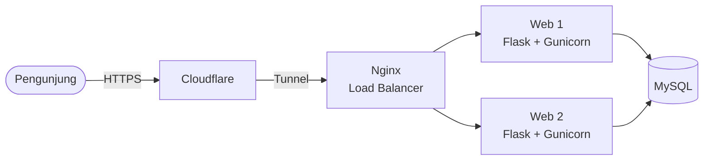

<div align="center">

# 🪵 Homey Wood

**Toko furnitur kayu solid online — dari katalog sampai pesanan sampai ke rumah.**

[](https://homeywood.web.id)


<br>

**Tim Pengembang · PBL_RKS_307 · RKS 3A Pagi**

| Nama | NIM |
|---|---|
| Muhamad Faris Kurniawan | 4332501004 |
| Hana Rafifa Helmi | 4332501016 |
| Najib Muhammad Ikvan | 4332501019 |
| Alicia Agatha Nathaniela T | 4332501029 |
| Destin Olivia Rengganis | 4332501032 |

</div>

---

## 📖 Tentang Proyek

**Homey Wood** adalah website e-commerce furnitur kayu solid. Pembeli bisa menjelajahi katalog sofa, meja, kursi, dan lemari, memasukkan produk ke keranjang, lalu checkout dengan perhitungan ongkir otomatis sesuai wilayah. Admin mengelola produk, pengguna, verifikasi pembayaran, pengiriman, dan melihat laporan penjualan.

Tampilan dibuat **responsif** (HP, tablet, desktop) dan tersedia **mode gelap**, karena sebagian besar pengguna membukanya lewat HP.

Proyek ini juga diterapkan sebagai **infrastruktur mini** yang aman dan berlapis: aplikasi berjalan di dua web server dalam container Docker, dibagi oleh Nginx sebagai load balancer, dan dipublikasikan ke internet lewat Cloudflare Tunnel.

---

## ✨ Fitur

### 🛍️ Pembeli
- Katalog produk dengan **pencarian**, **filter kategori** (Sofa, Meja, Kursi, Lemari), dan **filter material** (Kayu Jati, Kayu Mahoni, Rotan)
- Halaman detail produk dengan rating dan ulasan
- Keranjang belanja dengan badge jumlah item
- Checkout dengan tiga metode bayar: **Transfer Bank**, **QRIS (Midtrans)**, dan **Bayar di Tempat (COD)**
- **Ongkir otomatis** berdasarkan zona tujuan dan ukuran barang
- Unggah bukti pembayaran, lalu lacak status: *Menunggu Verifikasi → Diproses → Dikirim → Selesai*
- Konfirmasi **"Barang Sudah Tiba"**, lalu beri **bintang, ulasan, dan foto** per produk
- Komentar pada ulasan (pembeli lain dan admin dengan label *Penjual*)
- Profil, foto avatar, dan **lupa/reset password** lewat email

### 🧑‍💼 Admin
- **Dashboard laporan penjualan** dengan filter tanggal dan ekspor **Excel (.xlsx)** dan **PDF**
- **Kelola produk** (tambah, edit, hapus, unggah foto)
- **Kelola user** (aktifkan, nonaktifkan, hapus)
- **Verifikasi pembayaran** dan pengiriman pesanan, plus cetak **label pengiriman**

### 🔐 Keamanan
- Password disimpan sebagai **hash**, bukan teks asli
- Proteksi **CSRF** pada permintaan yang mengubah data (kecuali webhook Midtrans)
- Cookie sesi `HttpOnly`, `SameSite=Lax`, dan `Secure` saat produksi
- Validasi unggahan di sisi server: hanya **JPG, PNG, WEBP**, maksimal **2 MB**, jenis file dicek dari isi file (bukan sekadar ekstensi)
- **Logging** percobaan login gagal (login berhasil dan logout tidak dicatat)
- Container berjalan sebagai **user non-root** dengan *healthcheck*

---

<!--
## 🖼️ Tampilan
Tambahkan screenshot ke folder docs/screenshots/ lalu hapus tanda komentar ini.

| Beranda | Katalog |
|---|---|
|  |  |

| Dashboard Admin | Kelola Produk |
|---|---|
|  |  |
-->

## 🧱 Tech Stack

| Lapisan | Teknologi |
|---|---|
| Frontend | HTML, CSS, JavaScript (vanilla), desain di Figma |
| Backend | Python + Flask, Flask-Login, Flask-WTF (CSRF), Flask-SQLAlchemy, Flask-Migrate |
| Web server | Gunicorn (3 worker) |
| Database | MySQL 8.0 |
| Pembayaran | Midtrans Sandbox (QRIS dinamis) |
| Laporan | openpyxl (Excel) dan ReportLab (PDF) |
| Deployment | Docker + Docker Compose |
| Reverse proxy / Load balancer | Nginx |
| Jaringan / Gateway | Cloudflare (DNS, Tunnel, SSL/TLS) |

---

## 🏗️ Arsitektur



| Komponen | Berjalan di | Docker |
|---|---|---|
| Nginx (load balancer) | VM `nginx-dmz` | ✅ |
| Web 1 (Flask) | VM `web1-dmz` | ✅ |
| Web 2 (Flask) | VM `web2-dmz` | ✅ |
| MySQL | VM `mysql-db` | ❌ (data permanen, mudah dibackup) |

Permintaan dibagi bergantian (*round-robin*) ke web1 dan web2. Jika salah satu mati, Nginx otomatis memakai yang lain.

---

## 🗺️ Struktur URL

### Halaman

```
/                    → Beranda
/home                → Beranda
/katalog             → Katalog produk
/produk/<id>         → Detail produk
/keranjang           → Keranjang
/checkout            → Checkout
/profile             → Profil pembeli
/tentang             → Tentang kami
/kontak              → Kontak
/login
/register
/lupa-password
/reset-password

/admin-dashboard     → Dashboard laporan
/admin-katalog       → Kelola produk
/admin-user          → Kelola user
/admin-verifikasi    → Verifikasi bayar dan pengiriman
```

### API (`/api`)

```
Auth        POST /login  /register  /logout        GET /me
Produk      GET  /products  /products/<id>
Keranjang   GET  /cart        POST/PUT/DELETE /cart/items
Pesanan     GET  /orders      POST /orders         POST /orders/<kode>/confirm-arrived
Pembayaran  POST /orders/<kode>/qris  /proof       GET  /orders/<kode>/qris-status
Ulasan      GET  /products/<id>/reviews            POST /reviews  /reviews/<id>/comments
Profil      PUT  /profile                          POST/DELETE /profile/avatar
Password    POST /forgot-password  /reset-password
Admin       /admin/products  /admin/orders  /admin/users  /admin/report  /admin/dashboard

GET /health   → healthcheck (dipakai Docker)
```

---

## 📁 Struktur Proyek

```
PBL_RKS_307
├── docker-compose.yml          # menjalankan container web
├── nginx
│   ├── nginx.conf              # konfigurasi load balancer
│   └── gen-self-signed.sh      # membuat sertifikat self-signed (testing)
└── homeywood-site
    ├── Dockerfile
    ├── requirements.txt
    ├── config.py
    ├── run.py
    ├── create_admin.py         # membuat akun admin pertama
    ├── seed_products.py        # mengisi produk contoh
    ├── schema.sql              # skema database
    ├── migration_00X_*.sql     # migrasi bertahap
    ├── app
    │   ├── __init__.py         # create_app, route halaman, /health
    │   ├── auth.py             # register, login, logout
    │   ├── catalog.py          # produk dan CRUD admin
    │   ├── cart.py
    │   ├── orders.py           # checkout, verifikasi, pengiriman
    │   ├── midtrans.py         # QRIS Midtrans
    │   ├── reviews.py  ratings.py
    │   ├── password_reset.py
    │   ├── profile.py
    │   ├── admin_dashboard.py  admin_report.py  admin_users.py
    │   ├── uploads.py          # validasi dan penyimpanan foto
    │   ├── logging_setup.py
    │   └── models.py
    ├── pages                   # template HTML
    ├── css  js  img
    └── uploads                 # foto (tidak ikut git)
```

---

## 🚀 Menjalankan

### Dengan Docker (disarankan)

1. Ambil kode:
   ```bash
   git clone https://github.com/infrue27/PBL_RKS_307.git
   cd PBL_RKS_307
   mkdir -p homeywood-site/uploads homeywood-site/logs
   ```
2. Buat file `homeywood-site/.env` (lihat tabel variabel di bawah).
3. Jalankan:
   ```bash
   docker compose up -d --build
   docker compose ps
   curl -I http://localhost:8080/health      # harus 200 OK
   ```
Website berjalan di port `8080`. Untuk produksi, taruh Nginx di depannya (`nginx/nginx.conf`).

### Tanpa Docker (development)

```bash
cd homeywood-site
python -m venv venv
venv\Scripts\activate            # Windows  (Linux/macOS: source venv/bin/activate)
pip install -r requirements.txt
```

Siapkan database MySQL, lalu isi skemanya:
```bash
mysql -u root -p < schema.sql
# database lama: jalankan migration_002 ... migration_006 berurutan yang belum pernah dijalankan
python seed_products.py          # produk contoh (opsional)
python create_admin.py           # akun admin pertama
python run.py
```
Buka `http://127.0.0.1:5000`.

### Variabel `.env`

| Variabel | Keterangan |
|---|---|
| `SECRET_KEY` | Kunci rahasia sesi. **Wajib sama** di semua web server |
| `DB_HOST` `DB_PORT` `DB_USER` `DB_PASSWORD` `DB_NAME` | Koneksi MySQL |
| `COOKIE_SECURE` | `1` jika diakses lewat HTTPS |
| `BEHIND_PROXY` | `1` jika di belakang Nginx/Cloudflare (sudah diatur di compose) |
| `MIDTRANS_SERVER_KEY` | Server key Midtrans Sandbox (`SB-Mid-server-...`) |
| `MIDTRANS_BASE_URL` | Default `https://api.sandbox.midtrans.com` |
| `MAIL_HOST` `MAIL_PORT` `MAIL_USER` `MAIL_PASSWORD` `MAIL_FROM` | Email reset password. Kosongkan `MAIL_HOST` saat development, link reset dicetak di terminal |
| `APP_BASE_URL` | Alamat publik, mis. `https://homeywood.web.id` |

> ⚠️ File `.env` berisi rahasia. **Jangan pernah di-commit** (sudah ada di `.gitignore`).

---

## 🛠️ Troubleshoot

### Perintah Docker yang sering dipakai
```bash
docker compose up -d --build         # jalankan + build
docker compose ps                    # status container
docker compose logs --tail 50 web    # lihat log
docker compose down                  # matikan
docker compose up -d --force-recreate  # baca ulang .env (restart biasa tidak membaca ulang)
```

### Masalah umum

| Gejala | Penyebab | Solusi |
|---|---|---|
| `address already in use` di port 8080 | Nginx atau layanan lama masih memakai port itu | `sudo ss -tlnp \| grep 8080`, matikan layanannya (`systemctl stop` dan `disable`), lalu `docker compose down && docker compose up -d` |
| Login gagal atau tiba-tiba ter-logout | `SECRET_KEY` web1 dan web2 berbeda | Samakan `SECRET_KEY`, lalu `docker compose up -d --force-recreate` di kedua server |
| Foto produk tidak muncul | Folder `uploads/` kosong (tidak ikut git) | Salin isi `uploads/` dari server lama ke `homeywood-site/uploads/` |
| `ERR_TOO_MANY_REDIRECTS` | Cloudflare mode Flexible kirim HTTP ke Nginx yang mengalihkan ke HTTPS | Nginx port 80 harus membaca header `X-Forwarded-Proto` (sudah diterapkan di konfigurasi) |
| `502 Bad Gateway` | Container web mati atau belum sehat | `docker compose ps` dan `docker compose logs` di web1 dan web2 |
| Container `Restarting` | `.env` salah atau tidak lengkap | Periksa `docker compose logs`, pastikan `SECRET_KEY` dan `DB_*` terisi |

### Git
```bash
git pull --rebase                    # ambil update
git add .
git commit -m "pesan commit"
git pull --rebase
git push
```

---

<div align="center">

© 2026 Tim PBL_RKS_307 · Homey Wood

</div>
